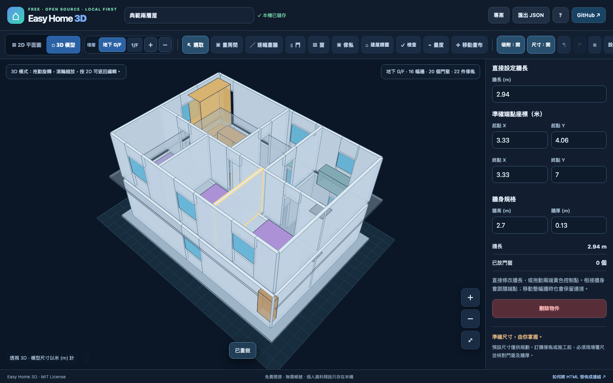
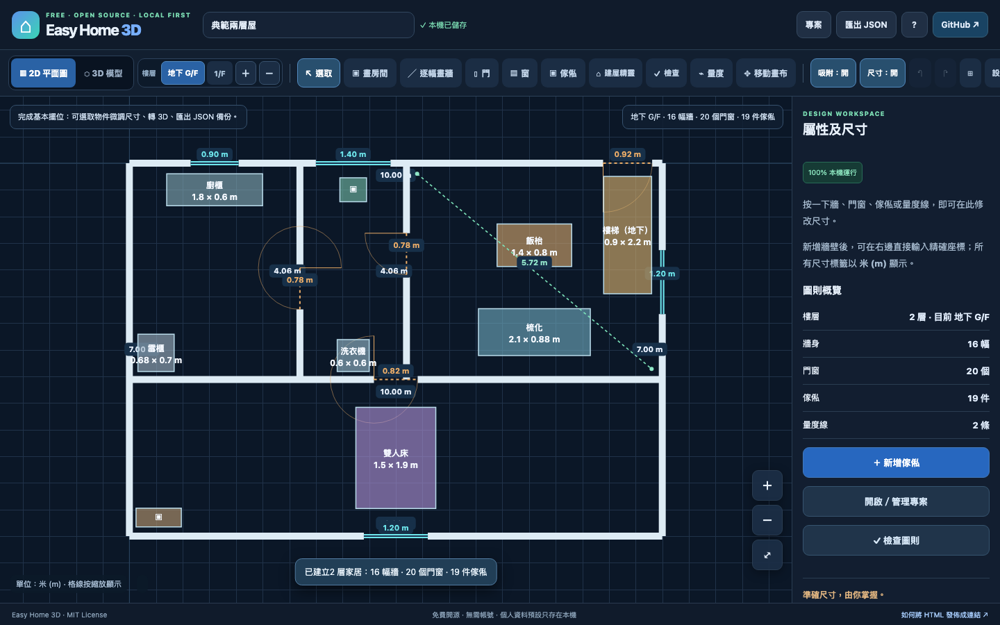

# Easy3DHome

**Plan your home in 2D. Explore it in 3D.**

Free, open-source home and furniture planner · No account required

免費開源 2D／3D 家居設計工具，毋須註冊。

### [Open web demo](https://easy-home-3d-open-source.bballinbrowser-loktoto.workers.dev/) · [Download for offline use](https://github.com/loktoto/Easy3DHomeModel/archive/refs/heads/main.zip)

[User guide](docs/USER_GUIDE.md) · [繁體中文教學](docs/USER_GUIDE.zh-Hant.md) · [Help & feedback](#help--feedback) · [MIT License](LICENSE)

> The existing online demo has not yet been verified against the current source. For a local copy, download the ZIP below. [Deployment status](https://github.com/loktoto/Easy3DHomeModel/issues/30).

## Get started

**No GitHub account, coding or installation is needed to use the editor.**

1. [Open the web demo](https://easy-home-3d-open-source.bballinbrowser-loktoto.workers.dev/) if available (phone, tablet or computer).
2. Or [download the ZIP](https://github.com/loktoto/Easy3DHomeModel/archive/refs/heads/main.zip) on your computer, extract the entire folder, then double-click `index.html`. Keep all extracted files together.

If you need help, see the [user guide](docs/USER_GUIDE.md). GitHub Pages is not enabled as of 27 November 2026.

*Example from earlier browser testing, not a screenshot of the latest release.*

## Design a room in three steps

1. Choose **Draw first room** or **Home wizard** and enter your measurements.
2. Add doors, windows and furniture; adjust sizes and positions.
3. Switch to **3D model** to explore the layout, then **Export JSON** to keep a backup.

*Earlier 2D editor screenshot. [More screenshots and test reports](docs/TESTING.md).*

## What you can do

| Design | Organize |
| --- | --- |
| Draw rooms and dimensioned walls | Manage multiple local projects |
| Place doors, windows and furniture | Save automatically in your browser |
| Explore 2D and 3D, up to five floors | Undo, redo, lock and duplicate items |
| Generate a one- or two-floor layout | Export and restore JSON backups |
| Measure distances and run basic plan checks | Use a mouse or touch controls |

The editor offers English, Traditional Chinese and Simplified Chinese language options. Full localization is still being validated. Future features are tracked in [Issues](https://github.com/loktoto/Easy3DHomeModel/issues); they are not promised as part of the current main branch.

## Help & feedback

| I want to… | Where to go |
| --- | --- |
| Learn to use the editor | [User guide](docs/USER_GUIDE.md) · [繁體中文教學](docs/USER_GUIDE.zh-Hant.md) |
| Recover a plan or fix a problem | [Troubleshooting and FAQ](docs/USER_GUIDE.md#troubleshooting-and-faq) |
| Report a bug or suggest an idea | [Open an issue](https://github.com/loktoto/Easy3DHomeModel/issues/new/choose) |
| See what is being developed | [Open issues](https://github.com/loktoto/Easy3DHomeModel/issues) |
| Build or self-host the app | [Developer guide](docs/DEVELOPMENT.md) |
| Contribute code | [Contributing](CONTRIBUTING.md) |

A free GitHub account is needed to submit feedback, but not to download or use the editor. Do not attach private home plans, addresses or credentials to public issues.

## Privacy and accuracy

The current local editor stores plans in your browser, not a cloud account. Export JSON regularly; clearing browser storage or using a different browser or site may make your plans inaccessible.

Easy3DHome is a planning aid, not a certified construction drawing or structural assessment. Verify dimensions, clearances, building regulations and actual site conditions with qualified professionals before purchasing or building.

## Project information

[Documentation index](docs/README.md) · [Test history](docs/TESTING.md) · [GitHub Actions](https://github.com/loktoto/Easy3DHomeModel/actions) · [MIT License](LICENSE)

Copyright © 2026 loktoto.
