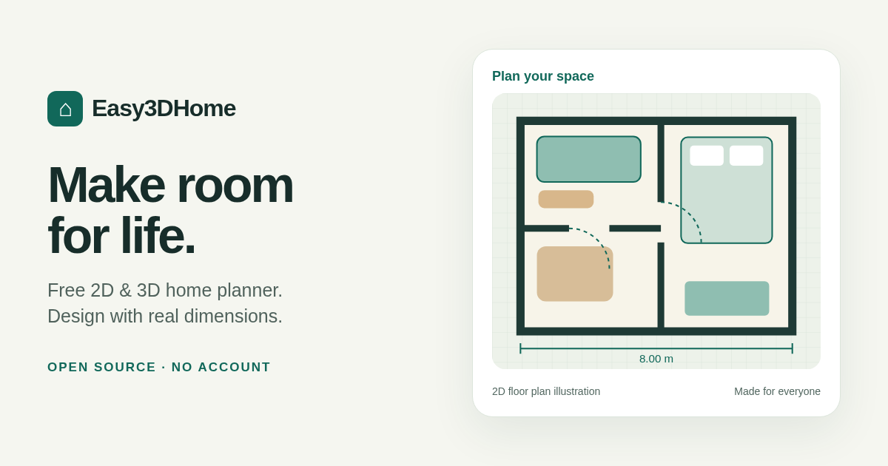

# Social preview and search metadata

[Home](../README.md) · [Release guide](RELEASING.md)

The 1200 × 630 PNG is a branded schematic, not an actual editor screenshot or private home plan. It is shared across the nine localized product landing pages. The production build adds localized title and description plus Open Graph and large-image Twitter metadata, checks every canonical and hreflang target, and allow-lists the PNG. Worker tests check its exact bytes and image MIME; packaged browser tests inspect the nine pages and the image.

Raw repository landing pages are developer sources. The full social metadata is generated by `python3 scripts/build-site.py`. Until the approved commit is deployed, do not advertise the image or metadata as publicly available. GitHub repository's separate social preview setting is managed by the owner in repository Settings.
