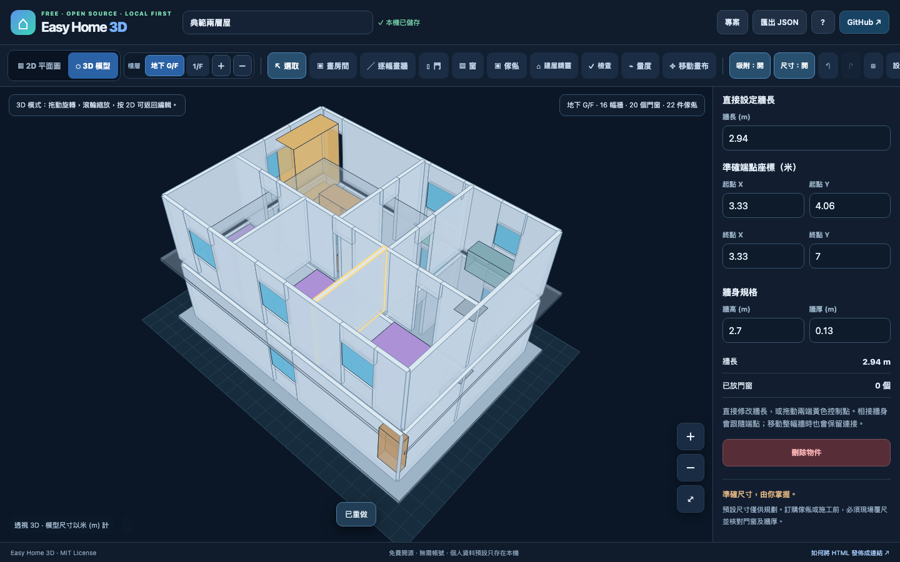
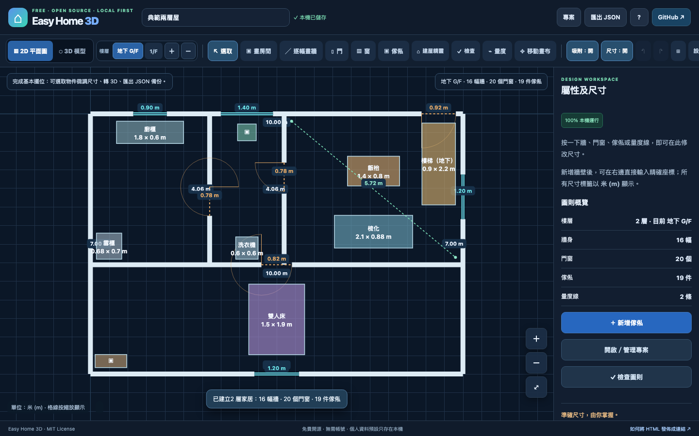
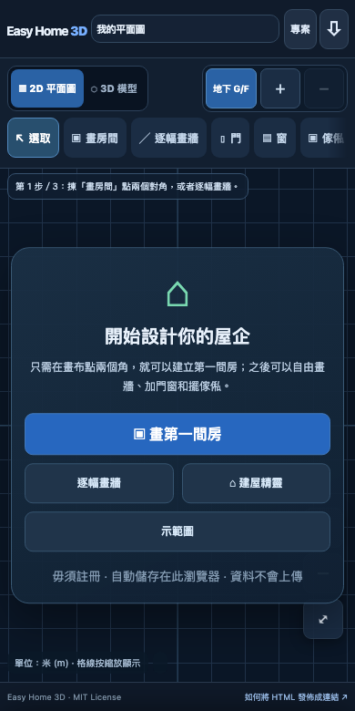

# Testing and screenshots

[Home](../README.md) · [Developer guide](DEVELOPMENT.md) · [Acceptance rules](QA_ACCEPTANCE.md)

## Historical browser screenshots

These are checked-in evidence from earlier testing, not a claim that current main or an open pull request has passed.

## Reports

- [Single-floor home browser report (HTML source)](../evidence/home-build-report.html)
- [Two-floor home browser report (HTML source)](../evidence/two-floor-home-report.html)
- [Responsive UI report (HTML source)](../evidence/responsive-ui-report.html)
- [UX audit](UX_E2E_AUDIT.md)

GitHub displays HTML as source. To view rendered reports, download/extract the repository and open the corresponding report in your browser with its evidence folder intact.

Earlier documentation reported 15 browser tests across Chromium/mobile WebKit and 18 unit tests, as well as 231 single-floor and 273 two-floor wizard combinations checked for geometry. These are historical results only; check exact-commit results in [GitHub Actions](https://github.com/loktoto/Easy3DHomeModel/actions).

Every PR requires current build/unit tests, desktop and mobile browser tests and actual screenshot review, per [QA_ACCEPTANCE.md](QA_ACCEPTANCE.md). Emulated WebKit does not substitute for a physical iPhone test. Do not treat unmerged features or historical screenshots as release acceptance.
