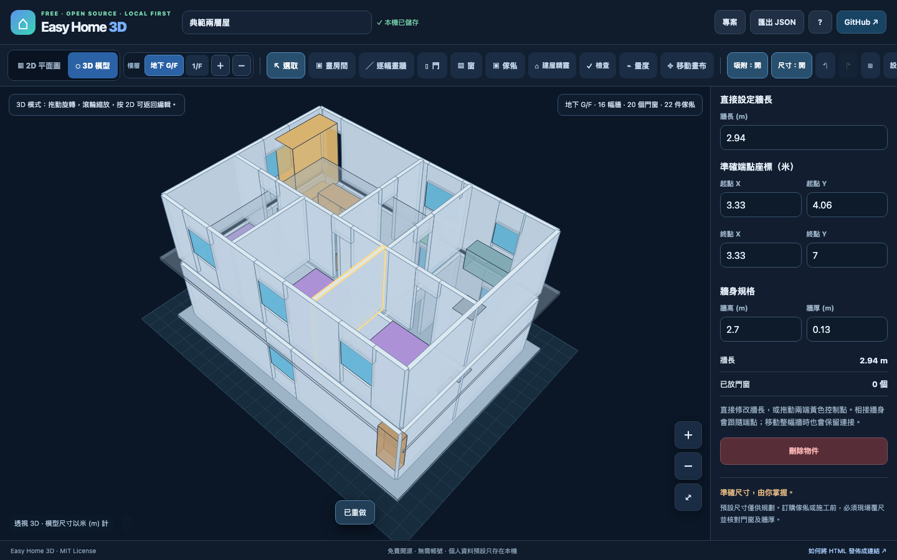
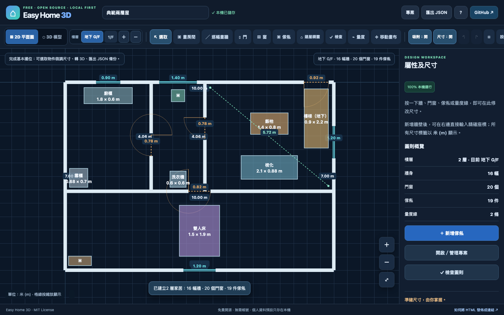
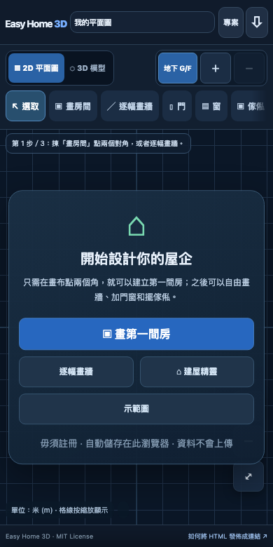

# Product screenshots and QA evidence

[Back to Easy3DHome](../README.md) · [QA rules](../docs/QA_ACCEPTANCE.md)

These are historical browser captures of example plans. They are not evidence of acceptance for the latest release.

## Explore the editor

### 3D home

### 2D floor plan

### Mobile

## Detailed reports

| Report | What it covers |
| --- | --- |
| [Single-floor home](home-build-report.html) | Building, furniture and checking |
| [Two-floor home](two-floor-home-report.html) | Floors, 3D and JSON restore |
| [Responsive UI](responsive-ui-report.html) | Historical mobile and desktop layouts |
| [UX audit](../docs/UX_E2E_AUDIT.md) | Findings and acceptance criteria |

GitHub displays the HTML reports as source; download/extract the repository and open the reports in a browser to see the rendered reports. Keep the images beside the reports. JSON files are historical example/verification data; do not substitute private plans.

For current evidence, use the [Actions run](https://github.com/loktoto/Easy3DHomeModel/actions) associated with the exact commit.
